# Laporan Hands-on 1 — Komponen MLflow (MLOPS P6)

| | |
|---|---|
| **Mata kuliah** | Machine Learning Operations (MLOps) — Minggu 6: Model Experimentation & Tracking |
| **Nama** | May Talitha Dahlia |
| **NIM** | 123450009 |
| **Program Studi** | Sains Data, Institut Teknologi Sumatera |
| **Tanggal** | 11 Oktober 2026 |

---

## 1. Tujuan dan Setup

Hands-on ini menguji lima komponen MLflow yang dibahas pada slide 42–50, yaitu logging dasar, logging per epoch, autologging, hyperparameter tuning dengan nested runs, pencarian run secara programatik, dan Model Registry.

| Item | Keterangan |
|---|---|
| Dataset | Breast Cancer Wisconsin dari scikit-learn, terdiri atas 569 sampel dan 30 fitur numerik |
| Split | Data latih 80% (455 sampel) dan data validasi 20% (114 sampel), menggunakan stratified split dengan random_state=42 |
| Label | Label asli scikit-learn: 1 = benign dan 0 = malignant. Dengan demikian, val_f1 mengukur F1-score kelas benign apabila evaluasi menggunakan label 1 sebagai kelas positif |
| Tracking server | MLflow Tracking Server dengan backend SQLite (mlflow.db) dan penyimpanan artefak lokal (./mlartifacts) |
| Versi | MLflow 3.17.0, scikit-learn 1.9.0, dan Python 3.11 |
| Eksperimen | breast-cancer-clf untuk Random Forest dan breast-cancer-dl untuk MLP berbasis PyTorch |

| Script | Slide | Komponen |
|---|---|---|
| src/logging_dasar.py | 42–43 | Pencatatan parameter, metrik, tag, dan model |
| src/pytorch_per_epoch.py | 44–45 | Pencatatan metrik per epoch, checkpoint, data_md5, dan informasi environment |
| src/autolog.py | 46 | Autologging dan pencatatan manual |
| src/optuna_nested.py | 47–48 | Optuna, 50 trial, dan nested runs |
| src/search_runs.py | 49 | Pencarian run menggunakan mlflow.search_runs |
| src/registry.py | 50 | Registrasi model, penggunaan alias, pemuatan model, dan prediksi |

Contoh deep learning pada materi menggunakan ResNet18 untuk data citra. Pada hands-on ini digunakan MLP berukuran 30 → 64 → 2 untuk data yang sama agar eksperimen dapat dijalankan dengan lebih ringan pada CPU. Pendekatan pencatatan eksperimen tetap mengikuti konsep MLflow yang dipelajari pada materi.

---

## 2. Hipotesis

Hipotesis disusun berdasarkan konsep MLflow pada slide 42–50 dan diuji melalui pelaksanaan setiap komponen eksperimen. Pengujian dilakukan dengan mengamati hasil pencatatan, visualisasi metrik, pencarian run, serta penggunaan Model Registry.

| Kode | Hipotesis | Indikator yang diamati |
|---|---|---|
| H1 | Satu run MLflow dapat menyimpan parameter, metrik, tag, dan model beserta artefak pendukungnya sehingga eksperimen dapat ditelusuri kembali. | Isi tab Overview dan Artifacts pada run rf-baseline |
| H2 | Logging per epoch memungkinkan perkembangan proses training diamati secara lebih terperinci, termasuk konvergensi dan indikasi overfitting yang tidak terlihat dari satu metrik akhir saja. | Kurva train_loss, val_loss, val_f1, dan lr pada setiap epoch |
| H3 | Autologging dapat mencatat parameter dan informasi eksperimen secara lebih lengkap dibandingkan pencatatan manual, sedangkan metrik evaluasi tertentu tetap perlu diperiksa atau dicatat secara manual. | Perbandingan parameter, metrik, dan informasi dataset pada run rf-baseline dan rf-autolog |
| H4 | Hyperparameter tuning menggunakan 50 trial Optuna dengan nested runs dapat mengidentifikasi konfigurasi hiperparameter yang menghasilkan nilai val_f1 terbaik pada data validasi. | Daftar 50 child run, nilai val_f1, konfigurasi hiperparameter terbaik, dan parallel coordinates plot |
| H5 | Run terpilih dapat dicari secara programatik, didaftarkan ke Model Registry, dan dimuat melalui alias @champion tanpa harus menuliskan nomor versi model secara langsung. | Hasil search_runs, informasi Model Registry, alias @champion, dan output prediksi |

---

## 3. Hasil

### 3.1 Logging dasar (H1)

Run rf-baseline menggunakan algoritma Random Forest dengan parameter n_estimators=200, max_depth=8, dan random_state=42. Berdasarkan hasil pada MLflow, run ini memperoleh nilai val_f1 sekitar 0,9655 dan val_auc sekitar 0,9940. Run tersebut mencatat tiga parameter, dua metrik, serta tag stage=baseline dan author=may. Hasil ini menunjukkan bahwa MLflow dapat menyimpan informasi eksperimen dalam satu run sehingga konfigurasi dan performa model dapat ditelusuri kembali.

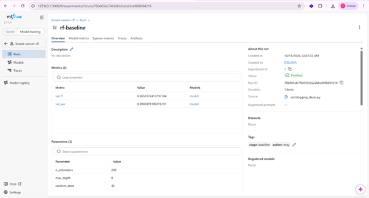

Gambar 1. Overview run rf-baseline: metrik, parameter, dan tag.

Artefak model yang dihasilkan mencakup MLmodel, conda.yaml, input_example.json, model.skops, python_env.yaml, requirements.txt, dan serving_input_example.json. Artefak tersebut menyimpan model beserta metadata dan informasi lingkungan perangkat lunak yang mendukung pemuatan model. File input_example.json menyediakan contoh format input model.

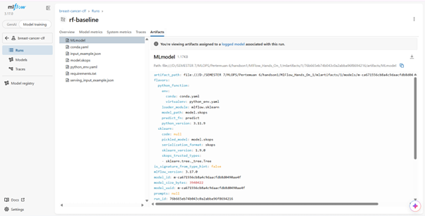

Gambar 2. Isi artefak model rf-baseline.

### 3.2 Logging per epoch — PyTorch (H2)

Run mlp64-lr0.003 (lr 0,003 dengan *cosine annealing*, batch 64, dropout 0,2, 20 epoch) mencatat
4 metrik di setiap epoch. Hasil terbaiknya **best_val_f1 = 0,9718**.

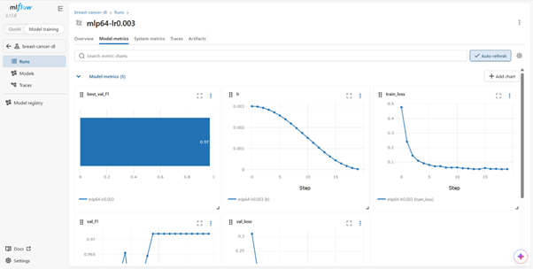

Gambar 3. Kurva metrik per epoch run mlp64-lr0.003.

Berdasarkan grafik metrik pada MLflow, diperoleh beberapa pengamatan berikut:

Learning rate (lr): menurun secara bertahap mengikuti pola cosine annealing hingga mendekati nol, sesuai dengan mekanisme scheduler yang digunakan.

Training loss (train_loss): turun tajam pada epoch awal, kemudian cenderung mendatar. Hal ini menunjukkan bahwa proses optimisasi mengalami konvergensi.

Validation F1-score (val_f1): berfluktuasi pada epoch awal, kemudian meningkat hingga sekitar 0,9718 dan relatif stabil pada epoch berikutnya.

Validation loss (val_loss): menurun tajam pada epoch awal, lalu cenderung mendatar pada nilai yang lebih rendah. Pada grafik yang ditampilkan, tidak terlihat kenaikan yang jelas pada epoch akhir sehingga belum terdapat indikasi kuat terjadinya overfitting berdasarkan pola val_loss tersebut.

Hasil ini menunjukkan bahwa logging per epoch membantu memantau perubahan performa model selama training. Informasi tersebut lebih terperinci dibandingkan hanya mencatat metrik pada akhir proses training.

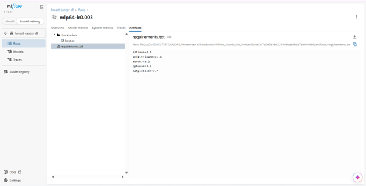

Gambar 4. Artefak run mlp64-lr0.003.

Checkpoint model terbaik, yaitu checkpoints/best.pt, dan file requirements.txt berhasil disimpan sebagai artefak pada run mlp64-lr0.003. Selain itu, nilai data_md5 dicatat sebagai parameter untuk membantu mengidentifikasi data yang digunakan dalam eksperimen. Pencatatan ini mendukung penelusuran artefak model dan informasi eksperimen.

### 3.3 Autolog vs logging manual (H3)

Model rf-autolog dilatih menggunakan konfigurasi Random Forest yang sama dengan rf-baseline, yaitu n_estimators=200, max_depth=8, dan random_state=42. Perbandingan kedua run menunjukkan beberapa perbedaan dalam pencatatan eksperimen.

| Aspek | rf-baseline (manual) | rf-autolog |
|---|---|---|
| Parameter | Tiga parameter yang dicatat secara manual | Parameter model yang dicatat otomatis, termasuk parameter default seperti bootstrap, ccp_alpha, dan class_weight |
| Metrik validasi | val_f1 dan val_auc | val_f1 dicatat secara manual, sedangkan val_auc tidak tercatat |
| Dataset | Informasi dataset tidak ditampilkan pada run | Informasi dataset tercatat pada kolom Dataset, termasuk nama dan digest |
| val_f1 | 0,965517 | 0,965517 |

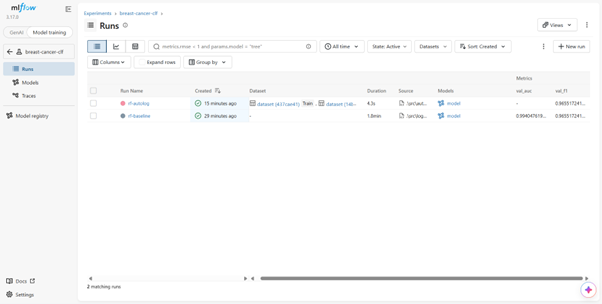

Gambar 5. Daftar run breast-cancer-clf.

Berdasarkan daftar run pada Gambar 5, dilakukan perbandingan lebih lanjut antara rf-baseline dan rf-autolog untuk melihat perbedaan pencatatan parameter, metrik evaluasi, dan informasi dataset. Perbandingan ini digunakan untuk mengetahui sejauh mana autologging melengkapi pencatatan eksperimen dibandingkan logging manual.

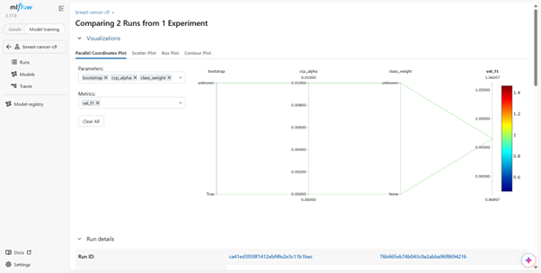

Gambar 6. Perbandingan rf-baseline dan rf-autolog.

### 3.4 Hyperparameter Tuning dengan Nested Runs (H4)

Parent run optuna-sweep-01 memiliki 50 child run, yaitu trial-0 hingga trial-49, yang tercatat dalam eksperimen MLflow. Setiap child run merepresentasikan satu percobaan dengan kombinasi hiperparameter yang berbeda. Hasil tuning memperoleh nilai terbaik best_val_f1 sebesar 0,9790, dengan konfigurasi learning rate sekitar 0,0091, batch size 32, dan dropout sekitar 0,320.

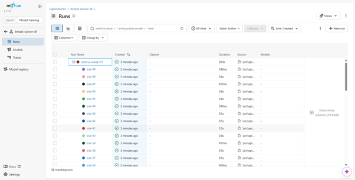

Gambar 7. Parent run optuna-sweep-01 dengan 50 child run.

Berdasarkan parallel coordinates plot, nilai val_f1 pada 50 trial berkisar antara 0,8136 hingga 0,9790. Grafik memperlihatkan bahwa hasil validasi berbeda pada setiap kombinasi hiperparameter yang diuji. Beberapa trial dengan nilai val_f1 rendah tampak menggunakan learning rate yang sangat kecil, sedangkan sejumlah trial dengan nilai val_f1 lebih tinggi menggunakan learning rate yang lebih besar. Namun, pola tersebut belum cukup untuk menyimpulkan bahwa learning rate merupakan hiperparameter yang paling menentukan performa model. Pengaruh masing-masing hiperparameter perlu ditafsirkan dengan mempertimbangkan kombinasi parameter lainnya.

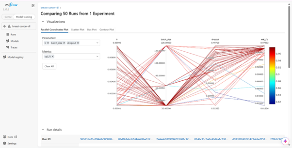

Gambar 8. Parallel coordinates 50 trial (lr, batch_size, dropout terhadap val_f1).

Hasil ini mendukung H4 karena proses tuning dengan 50 trial berhasil mengidentifikasi konfigurasi hiperparameter yang menghasilkan nilai val_f1 terbaik pada data validasi.

### 3.5 Pencarian Run dan Model Registry (H5)

Pencarian menggunakan search_runs dengan filter val_f1 > 0.95 dan max_depth = '8' menemukan dua run, yaitu rf-baseline dan rf-autolog, dengan nilai val_f1 yang sama, yaitu 0,965517. Run terpilih kemudian didaftarkan ke Model Registry dengan nama breast-cancer-clf versi 1. Model tersebut memiliki alias @challenger dan @champion, tag validation_status: passed, serta deskripsi "Random Forest depth=8, data v1". Source run untuk model versi ini adalah rf-autolog. Schema model mencakup satu input dan satu output sehingga model memiliki signature.

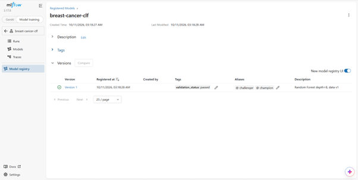

Gambar 9. Model Registry breast-cancer-clf.

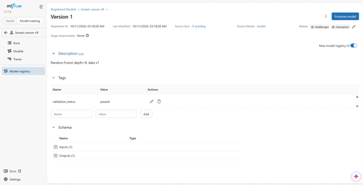

Gambar 10. Detail versi 1: alias, tag, source run, dan schema.

Model kemudian dimuat menggunakan alias models:/breast-cancer-clf@champion dan digunakan untuk memprediksi lima sampel validasi. Hasil prediksi dibandingkan dengan label aktual sebagai berikut.

| Keterangan | Sampel 1 | Sampel 2 | Sampel 3 | Sampel 4 | Sampel 5 |
|---|---:|---:|---:|---:|---:|
| Prediksi | 0 | 1 | 0 | 0 | 0 |
| Label aktual | 0 | 1 | 0 | 1 | 0 |

Hasil prediksi menunjukkan bahwa empat dari lima sampel memiliki prediksi yang sesuai dengan label aktual. Satu kesalahan terjadi pada sampel ke-4, dengan label aktual 1 (benign), tetapi model memprediksi 0 (malignant). Hasil ini menunjukkan bahwa model berhasil dimuat melalui alias @champion dan digunakan untuk melakukan prediksi tanpa menyebutkan nomor versi secara langsung.

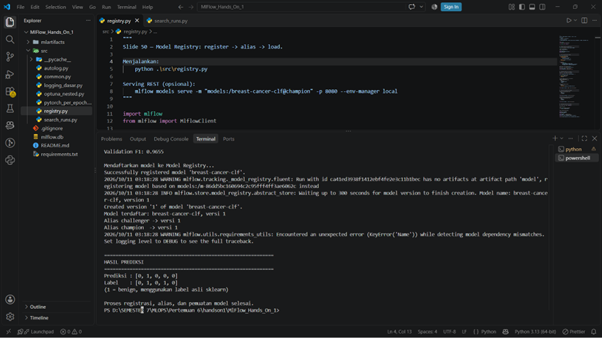

Gambar 11. Output terminal registrasi dan prediksi via alias.

---

## 4. Pembahasan

**Seleksi otomatis membutuhkan tie-breaker.** rf-baseline dan rf-autolog memiliki nilai val_f1 yang identik, sehingga terjadi skor seri. Jika search_runs hanya mengurutkan berdasarkan val_f1, pemilihan run ketika terjadi seri tidak memiliki kriteria pembeda yang eksplisit. Pada eksperimen ini, run yang terdaftar adalah rf-autolog. Dalam pipeline otomatis, kondisi tersebut dapat menyebabkan pemilihan model berbeda ketika beberapa run memiliki skor yang sama. Untuk mengatasinya, tambahkan kriteria kedua pada order_by, misalnya val_auc DESC atau start_time ASC, sesuai tujuan pemilihan model.

**Validasi dengan 114 sampel membatasi resolusi metrik.** Pada data validasi yang terdiri atas 114 sampel, satu sampel setara dengan sekitar 0,88 poin persentase akurasi. Selisih nilai best_val_f1 antara trial terbaik Optuna (0,9790) dan rf-baseline (0,9655) adalah sekitar 0,0135. Namun, nilai F1 tidak dapat langsung diterjemahkan menjadi jumlah sampel yang berbeda karena perhitungannya bergantung pada precision dan recall. Beberapa trial juga dapat memperoleh skor yang sama, sehingga konfigurasi hiperparameter terbaik belum tentu unik. Nilai terbaik dari 50 percobaan pada validation set yang sama berpotensi optimistis karena pemilihan dilakukan berdasarkan performa pada data validasi tersebut (*winner's curse*).

**Perbandingan MLP dan tuning tidak terkontrol.** Run mlp64-lr0.003 dilatih selama 20 epoch menggunakan scheduler, sedangkan trial Optuna menggunakan 15 epoch tanpa scheduler. Karena jumlah epoch dan penggunaan scheduler berbeda, perubahan nilai val_f1 dari 0,9718 menjadi 0,9790 tidak dapat diatribusikan hanya pada perubahan hiperparameter. Perbandingan yang lebih terkontrol memerlukan konfigurasi eksperimen yang sama, kecuali hiperparameter yang memang sedang diuji.

**Environment yang tercatat belum sepenuhnya terkunci.** File requirements.txt yang dicatat secara manual pada run mlp64-lr0.003 berisi rentang versi, seperti mlflow>=3.0 dan torch>=2.2, bukan versi paket yang terpasang secara persis. Untuk meningkatkan reproduktibilitas, versi paket dapat dicatat menggunakan pip freeze. Sementara itu, requirements.txt yang dihasilkan otomatis pada artefak model perlu diperiksa untuk memastikan apakah seluruh versi dependensi yang diperlukan sudah tercatat secara spesifik.

**Model pada MLflow 3 dapat disimpan sebagai entitas terpisah.** Pada run mlp64-lr0.003, model tidak terlihat sebagai folder biasa pada tab Artifacts, tetapi ditampilkan melalui bagian Logged Model yang tertaut ke run. Hal ini sesuai dengan mekanisme pencatatan model pada MLflow 3. Untuk pencatatan model PyTorch, input_example dapat disertakan agar format input model terdokumentasi dan signature dapat dibentuk sesuai kebutuhan pemuatan serta inferensi model.

**Peringatan KeyError('Name') saat pemuatan model.** Pada proses pemuatan model muncul peringatan KeyError('Name') ketika MLflow melakukan pemeriksaan terkait dependensi. Prediksi tetap berhasil dijalankan pada eksperimen ini. Namun, penyebab spesifik peringatan tersebut belum dapat dipastikan hanya berdasarkan pesan yang tersedia, sehingga diperlukan pemeriksaan lebih lanjut terhadap log lengkap dan metadata dependensi sebelum menyimpulkan bahwa peringatan tersebut tidak memengaruhi proses pemuatan model.

---

## 5. Kesimpulan

| Kode | Status | Bukti |
|---|---|---|
| H1 | Didukung | rf-baseline menyimpan 3 parameter, 2 metrik, 2 tag, dan model beserta artefak pendukung seperti requirements.txt, conda.yaml, dan input_example.json. |
| H2 | Didukung | Kurva per epoch menunjukkan penurunan train_loss dan perkembangan val_f1 hingga mencapai nilai terbaik 0,9718. Informasi ini lebih terperinci dibandingkan hanya melihat nilai best_val_f1 pada akhir training. |
| H3 | Didukung sebagian | Autolog mencatat lebih banyak parameter dan informasi dataset beserta digest-nya. Namun, val_auc tidak tercatat pada run rf-autolog dan konteks asal-usul serta versi data belum sepenuhnya diketahui. |
| H4 | Didukung | Dari 50 trial Optuna, konfigurasi terbaik menghasilkan best_val_f1 sebesar 0,9790. Hasil ini menunjukkan bahwa tuning dapat mengidentifikasi konfigurasi terbaik pada data validasi yang digunakan, tetapi belum membuktikan bahwa satu hiperparameter tertentu paling menentukan performa. |
| H5 | Didukung dengan catatan | Model berhasil dimuat melalui alias @champion tanpa menuliskan nomor versi dan memprediksi 4 dari 5 sampel dengan benar. Namun, aturan seleksi run belum memiliki tie-breaker yang eksplisit ketika skor sama. |

Secara keseluruhan, kelima komponen MLflow yang diuji dapat digunakan untuk mencatat, mengevaluasi, mencari, dan mengelola model. Pelajaran penting yang diperoleh dari eksperimen ini adalah sebagai berikut.

1. **Aturan seleksi harus lengkap.** Skor yang sama pada beberapa run memerlukan kriteria tambahan agar pemilihan model mengikuti aturan yang jelas dan konsisten.

2. **Ukuran data validasi memengaruhi interpretasi hasil.** Data validasi yang terdiri atas 114 sampel membatasi resolusi evaluasi. Namun, selisih F1-score tidak dapat langsung diterjemahkan menjadi jumlah sampel yang berbeda karena F1-score bergantung pada precision dan recall.

3. **Klaim dalam materi perlu diuji melalui eksperimen.** Pada eksperimen ini, autologging di MLflow 3.17 mencatat informasi dataset beserta digest-nya. Namun, informasi tersebut belum tentu menjelaskan seluruh konteks asal-usul dan versi data yang digunakan.

---

## 6. Keterbatasan

- **Penggunaan satu split validasi.** Evaluasi dilakukan menggunakan satu pembagian data dan satu nilai random seed, tanpa cross-validation atau pengujian dengan beberapa seed. Oleh karena itu, variasi performa model pada pembagian data yang berbeda belum diketahui.

- **Tidak menggunakan test set terpisah.** Seluruh metrik performa yang dilaporkan berasal dari data validasi. Dengan demikian, performa model pada data terpisah yang tidak digunakan dalam proses pemilihan model belum dapat dievaluasi.

- **Hipotesis belum memiliki kriteria kuantitatif yang ditetapkan sebelumnya.** Hipotesis dievaluasi berdasarkan pengamatan terhadap hasil eksperimen dan pencatatan MLflow. Namun, ambang numerik untuk menentukan keberhasilan setiap hipotesis belum ditetapkan sebelum eksperimen dilakukan.